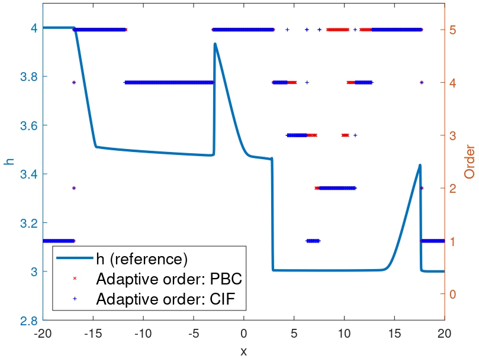
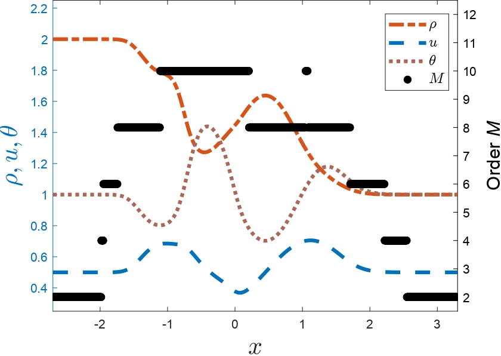
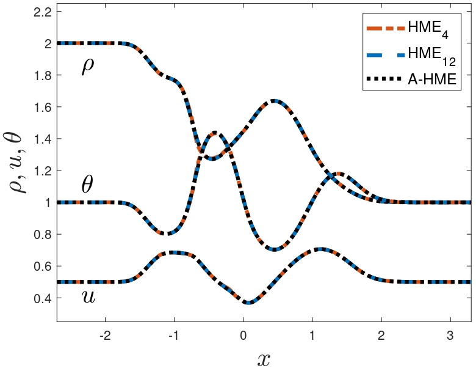

# PhD-RUG – Spatially Adaptive Moment Models

This repository contains the software and mathematical derivations developed during my PhD research at the **University of Groningen**.

The research focuses on the derivation, analysis and numerical simulation of adaptive moment models, with applications to **shallow free-surface flows** and **rarefied gas dynamics**. The repository contains analytical derivations, reference simulation codes and numerical software developed to investigate and simulate these mathematical models.

## Repository Structure

The repository is organized into three main components:

### 1. `reference-codes/`

Contains Wolfram Mathematica files (`.nb` and `.m`) used to run reference simulations.

These codes provide reference solutions and numerical results for the mathematical models for shallow free-surface flows investigated in the research. The reference solutions were obtained using a modified version of the software accompanying the paper J. Kowalski and M. Torrilhon, Moment Approximations and Model Cascades for Shallow Flow, Commun. Comput. Phys. 25, 669 (2019), https://doi.org/10.4208/cicp.OA-20170263.

### 2. `moment-model-derivations/`

Contains Wolfram Mathematica notebooks (`.nb`) with analytical derivations of the moment models.

These notebooks document the mathematical development of the models considered throughout the research.

### 3. `spatially-adaptive-moment-models/`

Contains the main numerical software developed for the simulation of spatially adaptive moment models. It is divided into separate components for linear and nonlinear systems, together with additional supporting material.

The two main components are:

- **`linear-systems/`** – Contains Wolfram Mathematica notebooks and associated images related to linear moment systems.
- **`nonlinear-systems/`** – Contains the Python implementation for the numerical simulation of nonlinear moment models.

The `nonlinear-systems/` directory is the main entry point for running the Python simulations.

## Running a Simulation

The nonlinear moment-model simulations are executed through `main.py`.

### 1. Configure the simulation

Navigate to:

```text
spatially-adaptive-moment-models/nonlinear-systems/
```

Before running a simulation, open:

```text
config-files/config.txt
```

Specify the desired simulation settings in this file, including the initial conditions, boundary conditions and numerical method used to solve the governing differential equations.

An example configuration file for the **adaptive 1D Shallow Water Moment Equations** is available in:

```text
config-files/ConfigSWME1D/
```

An example configuration file for the **adaptive 1D Hyperbolic Moment Equations** is available in:

```text
config-files/ConfigHME1D/
```

### 2. Run the simulation

From the `nonlinear-systems/` directory, execute:

```bash
python main.py
```

The simulation will run using the settings specified in `config-files/config.txt`.

Make sure that Python and the packages required by the simulation are installed in your environment before running the program.

## Representative simulation results

The following figures illustrate numerical simulations of adaptive moment
models for shallow free-surface flows and rarefied gas dynamics.

<p align="center">
  
  
  
</p>

<p align="center">
  <em>
    Left: Shallow-water simulation comparing adaptive moment models with a
    reference solution.
    Middle: Rarefied-gas simulation showing macroscopic profiles and the
    spatially varying moment order.
    Right: Rarefied-gas simulation showing macroscopic profiles for 
    adaptive simulations and classical simulations.
  </em>
</p>

## Scientific Background

The software in this repository was developed as part of the PhD research:

**Model-adaptive simulation of moment models with applications in shallow free-surface flows and rarefied gases**

The thesis investigates spatially and temporally adaptive simulation methods for hierarchical moment models, with the objective of balancing computational efficiency and numerical accuracy.

For further information about the mathematical models and numerical methods, see the accompanying PhD thesis:

[PhD thesis – University of Groningen](https://research.rug.nl/en/publications/model-adaptive-simulation-of-moment-models-with-applications-in-s/)

## Citation

When using the mathematical derivations or software in this repository, please refer to the associated PhD thesis:

> Verbiest, R. (2026). *Model-adaptive simulation of moment models with applications in shallow free-surface flows and rarefied gases*. PhD thesis, University of Groningen.
